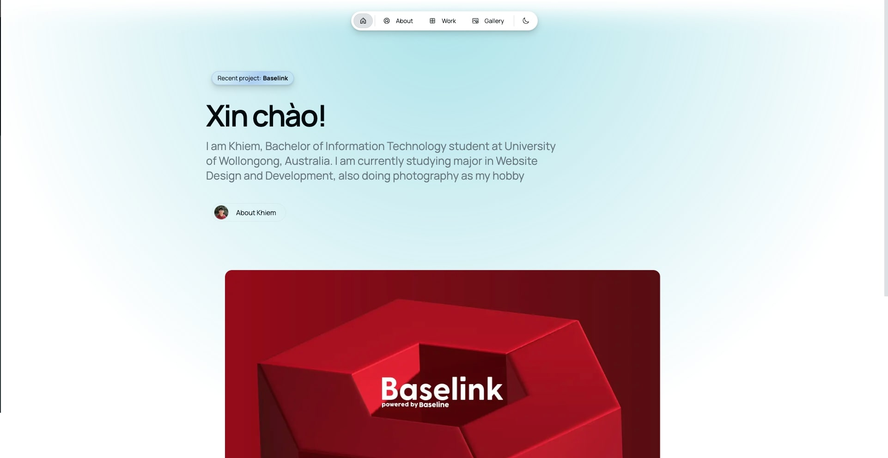

# Magic Portfolio

Magic Portfolio is a simple, clean, beginner-friendly portfolio template. It supports an MDX-based content system for projects and blog posts, an about / CV page and a gallery.

View the demo [here](https://magic-portfolio-demo.vercel.app).



Launch your portfolio on [Aveiro](https://www.aveiro.app/marketplace/spotlight), our managed publishing platform. Update case studies, blog posts and content through MCP from your favorite AI tools.

## Getting started

**1. Clone the repository**
```
git clone https://github.com/once-ui-system/magic-portfolio.git
```

**2. Install dependencies**
```
npm install
```

**3. Run dev server**
```
npm run dev
```

**4. Edit config**
```
src/resources/once-ui.config.ts
```

**5. Edit content**
```
src/resources/content.tsx
```

**6. Create blog posts / projects**
```
Add a new .mdx file to src/app/blog/posts or src/app/work/projects
```

Magic Portfolio was built with [Once UI](https://once-ui.com) for [Next.js](https://nextjs.org). It requires Node.js 20.9 or later.

## Documentation

Docs available at: [docs.once-ui.com](https://docs.once-ui.com/docs/magic-portfolio/quick-start)

## Features

### Once UI
- All tokens, components & features of [Once UI](https://once-ui.com)

### SEO
- Automatic open-graph and X image generation with next/og
- RSS feed at `/api/rss`
- Automatic schema and metadata generation based on the content file

### Design
- Responsive layout optimized for all screen sizes
- Timeless design without heavy animations and motion
- Endless customization options through [data attributes](https://once-ui.com/docs/theming)

### Content
- Render sections conditionally based on the content file
- Enable or disable pages for blog, work, gallery and about / CV
- Generate and display social links automatically
- Set up password protection for URLs
- Write math in posts with LaTeX between `$$` signs, rendered with KaTeX

### Newsletter
- Signups from the home page and blog go straight into your [Aveiro](https://www.aveiro.app) audience, where you also write and send the newsletter
- Create an embed form in Aveiro under Audience → Embed and paste its public ID as `aveiroEmbedId` in `src/resources/once-ui.config.ts`

### Localization
- A localized, earlier version of Magic Portfolio is available with the next-intl library
- To use localization, switch to the [`localization-(Once-UI-0.4.2)`](https://github.com/once-ui-system/magic-portfolio/tree/localization-%28Once-UI-0.4.2%29) branch

## Creators

Lorant One: [Threads](https://www.threads.net/@lorant.one) / [LinkedIn](https://www.linkedin.com/in/lorant-one/)

## Get involved

- Join the Design Engineers Club on [Discord](https://discord.com/invite/5EyAQ4eNdS) and share your project with us!
- Deployed your docs? Share it on the [Once UI Hub](https://once-ui.com/hub) too! We feature our favorite apps on our landing page.

## License

Distributed under the CC BY-NC 4.0 License.
- Attribution is required.
- Commercial usage is not allowed.
- You can extend the license to [Dopler CC](https://dopler.app/license) by purchasing a [Once UI Pro](https://once-ui.com/pricing) license.

See `LICENSE` for more information.

## Deploy with Vercel

[](https://vercel.com/new/clone?repository-url=https%3A%2F%2Fgithub.com%2Fonce-ui-system%2Fmagic-portfolio&project-name=portfolio&repository-name=portfolio&redirect-url=https%3A%2F%2Fgithub.com%2Fonce-ui-system%2Fmagic-portfolio&demo-title=Magic%20Portfolio&demo-description=Showcase%20your%20designers%20or%20developer%20portfolio&demo-url=https%3A%2F%2Fmagic-portfolio-demo.vercel.app&demo-image=%2F%2Fraw.githubusercontent.com%2Fonce-ui-system%2Fmagic-portfolio%2Fmain%2Fpublic%2Fimages%2Fog%2Fhome.jpg)
