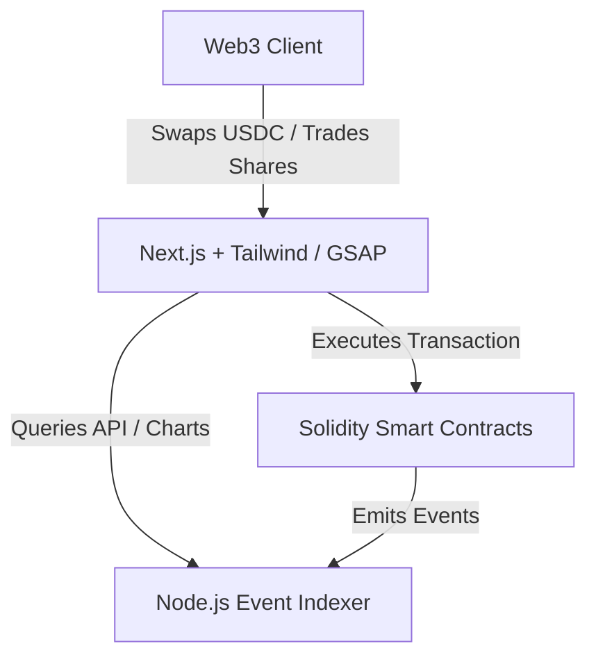

## Technical Overview

Prediction markets allow users to trade on the outcome of future events. This post examines the architectural and mathematical implementation of **Arcade**, a prediction market Proof of Concept (PoC) deployed on the **Arc Testnet (Circle L1)**. The system relies on a Constant Product Market Maker (CPMM) to provide continuous liquidity, smart contracts written in Solidity, a custom Node.js indexer for event tracking, and a cyberpunk-themed Next.js interface.


---

## System Architecture

The platform architecture is designed to handle trades with minimal latency while ensuring that user portfolio details and market prices update in real time.



---

## 1. Automated Market Maker (AMM) Mechanics

In traditional order-book prediction markets, low-volume events can suffer from illiquidity and wide spreads. Arcade solves this by using a **Constant Product Market Maker** ($x \cdot y = k$) to facilitate continuous, instant share swaps.

Inside each prediction pool:
*   $x$ represents the reserve of **YES** shares.
*   $y$ represents the reserve of **NO** shares.
*   $k$ is the constant product.

### Collateralization and Share Minting
All bets are fully collateralized by USDC. When a user wishes to buy shares:
1.  The user deposits $1$ USDC to the contract.
2.  The contract mints $1$ YES share and $1$ NO share (backed by the $1$ USDC).
3.  Depending on the user's prediction, one type of share is returned to the user, and the other is swapped into the AMM liquidity pool to maintain the constant product invariant.

### Pricing Calculations
The market price of each outcome represents the implied probability of the event occurring. The price of a YES share is calculated from the reserves of both outcomes:

<LatexRenderer displayMode>{`\\text{Price}_{\\text{YES}} = \\frac{y}{x + y}`}</LatexRenderer>

As users buy YES shares, the pool's YES reserves decrease and NO reserves increase, automatically shifting the price upward to reflect the new market demand.


---

## 2. Factory Pattern & Solidity Contracts

To allow permissionless creation of new prediction markets, the system implements a Factory contract structure. This decouples the deployment registry from individual pool logic.

```solidity
// SPDX-License-Identifier: MIT
pragma solidity ^0.8.20;

import "./PredictionMarket.sol";

contract MarketFactory {
    address[] public allMarkets;
    address public immutable usdcToken;

    event MarketCreated(address indexed marketAddress, string question, uint256 endTime);

    constructor(address _usdcToken) {
        usdcToken = _usdcToken;
    }

    function createMarket(string calldata question, uint256 endTime) external returns (address) {
        PredictionMarket newMarket = new PredictionMarket(question, endTime, usdcToken, msg.sender);
        allMarkets.push(address(newMarket));
        emit MarketCreated(address(newMarket), question, endTime);
        return address(newMarket);
    }
}
```

Each `PredictionMarket` contract is responsible for:
*   Enforcing trade slippage and calculations.
*   Custodying USDC collateral safely.
*   Distributing winning payouts after the market owner resolves the outcome.


---

## 3. Invariant Fuzz Testing via Foundry

Because CPMM pools handle direct mathematical swaps, any logic or rounding errors could result in loss of pool funds. We implemented property-based **fuzz testing** in Foundry to verify AMM invariants under arbitrary transaction sizes.

```solidity
function testFuzz_CPMM_Invariants(uint256 buyAmount) public {
    // Restrict fuzz inputs to realistic transaction boundaries
    vm.assume(buyAmount > 100 && buyAmount < 1_000_000 * 10**6);
    
    // Store pre-transaction product constant
    uint256 initialK = market.x() * market.y();
    
    // Perform simulated trade
    vm.prank(user);
    market.buyYesShares(buyAmount);
    
    // Validate that the constant product did not decrease
    uint256 finalK = market.x() * market.y();
    assertGe(finalK, initialK, "Constant product invariant violated!");
}
```

---

## 4. Real-time Event Indexing

To build responsive charts and display up-to-date portfolio lists, the application utilizes a custom Node.js indexer. Directly polling the blockchain RPC for historical logs is slow and resource-intensive. 

The indexer:
1.  Listens to on-chain swap and creation logs emitted by Arc RPC nodes.
2.  Parses and stores them in a local database.
3.  Serves indexed API endpoints that feed historical volume and price trajectory data to the frontend.


---

## Tech Stack Overview

-   **Smart Contracts:** Solidity, Foundry (Fuzzing / Invariant testing).
-   **Frontend:** Next.js (TypeScript), Framer Motion, GSAP, TailwindCSS.
-   **Indexer:** Node.js, Custom event tracking schema.
