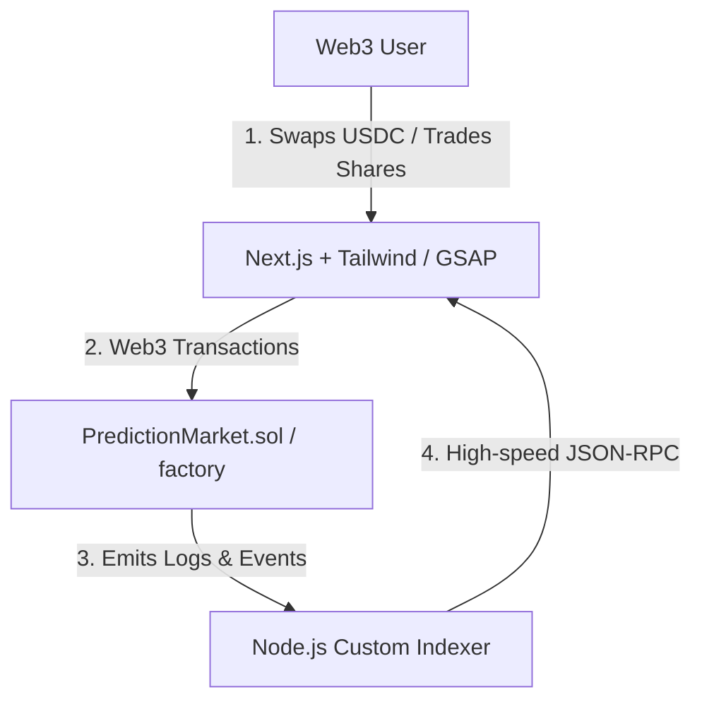

## The Vision: High-Fidelity Cyberpunk Prediction Markets

Traditional prediction markets often suffer from two major pain points: high latency in trade execution/settlement, and fragmented or dry liquidity. 

With the emergence of the **Arc L1 Testnet (Circle L1)**, we recognized an opportunity to build a high-fidelity prediction market proof-of-concept (**Arcade**) that solves these issues. Arcade blends a responsive cyberpunk design (Void Black and Neon Cyan theme) with a Constant Product Market Maker (CPMM) model to supply continuous, automated liquidity for real-world event shares.


---

## Technical Architecture & Flow

Arcade is composed of three interconnected layers designed to deliver near-instantaneous trades and deep liquidity:



---

## 1. Constant Product Market Maker (CPMM) Mechanics

In traditional prediction markets, order books can lead to unfilled trades. Arcade mitigates this by representing prediction outcomes (e.g., YES and NO) as ERC-20 shares inside an AMM pool. We utilize a customized **Constant Product Market Maker** ($x \cdot y = k$ invariant) where:

*   $x$ represents the pool's balance of **YES** shares.
*   $y$ represents the pool's balance of **NO** shares.
*   $k$ is the constant product.

When a user purchases shares, they deposit USDC as collateral. The contract mints equal amounts of YES and NO shares, keeps the outcome they chose, and swaps the other outcome into the liquidity pool to maintain the mathematical invariant.

<LatexRenderer displayMode>{`\\text{Price}_{\\text{YES}} = \\frac{y}{x + y}`}</LatexRenderer>

This ensures that the implied probability of the outcomes always sums to 1 (or 100%), creating a mathematically sound, self-balancing ecosystem.

---

## 2. Solidity Contracts & Factory Pattern

To make the creation of prediction markets completely permissionless and standardized, we implemented a Factory pattern:

```solidity
// SPDX-License-Identifier: MIT
pragma solidity ^0.8.20;

import "./PredictionMarket.sol";

contract MarketFactory {
    address[] public allMarkets;
    address public immutable usdcToken;

    event MarketCreated(address indexed marketAddress, string question, uint256 endTime);

    constructor(address _usdcToken) {
        usdcToken = _usdcToken;
    }

    function createMarket(string calldata question, uint256 endTime) external returns (address) {
        PredictionMarket newMarket = new PredictionMarket(question, endTime, usdcToken, msg.sender);
        allMarkets.push(address(newMarket));
        emit MarketCreated(address(newMarket), question, endTime);
        return address(newMarket);
    }
}
```

Every deployed `PredictionMarket` contract securely custody's USDC collateral, manages pool balances, handles calculations for swap slippage, and distributes payouts to the winning option holders once the oracle resolves the final outcome.

---

## 3. Rigorous Testing & Invariant Fuzzing

Because CPMM math handles direct asset swaps, rounding errors or pool imbalances could theoretically drain funds. To prevent this, we built a comprehensive test suite using **Foundry**. 

In addition to standard unit tests, we integrated **fuzz testing** to stress-test key invariants:

```solidity
function testFuzz_CPMM_Invariants(uint256 buyAmount) public {
    // Restrict inputs to realistic ranges
    vm.assume(buyAmount > 100 && buyAmount < 1_000_000 * 10**6);
    
    // Track pre-state
    uint256 initialK = market.x() * market.y();
    
    // Execute trade simulation
    vm.prank(user);
    market.buyYesShares(buyAmount);
    
    // Assert constant product k has increased or stayed equal (due to rounding)
    uint256 finalK = market.x() * market.y();
    assertGe(finalK, initialK, "Constant product invariant violated!");
}
```

This guarantees that under any transaction size, the pool remains financially stable, and users can never withdraw more USDC than they are mathematically entitled to.

---

## 4. Real-time Event Indexing

To provide a zero-latency UI, the frontend doesn't query the smart contracts directly for historical trades. Instead, we run a custom **Node.js indexer** that:

1.  Subscribes to `MarketCreated` and swap events emitted by Arc L1 RPC nodes.
2.  Persists the logs into a structured database.
3.  Serves structured API endpoints so the frontend can display historical volume, liquidity, and probability chart lines with sub-second response times.

---

## Summary

By combining **Circle's Arc L1** speed with a customized **Constant Product AMM** and robust smart contract testing, Arcade showcases what next-generation prediction platforms can look like: fast, continuous, secure, and visually immersive.
