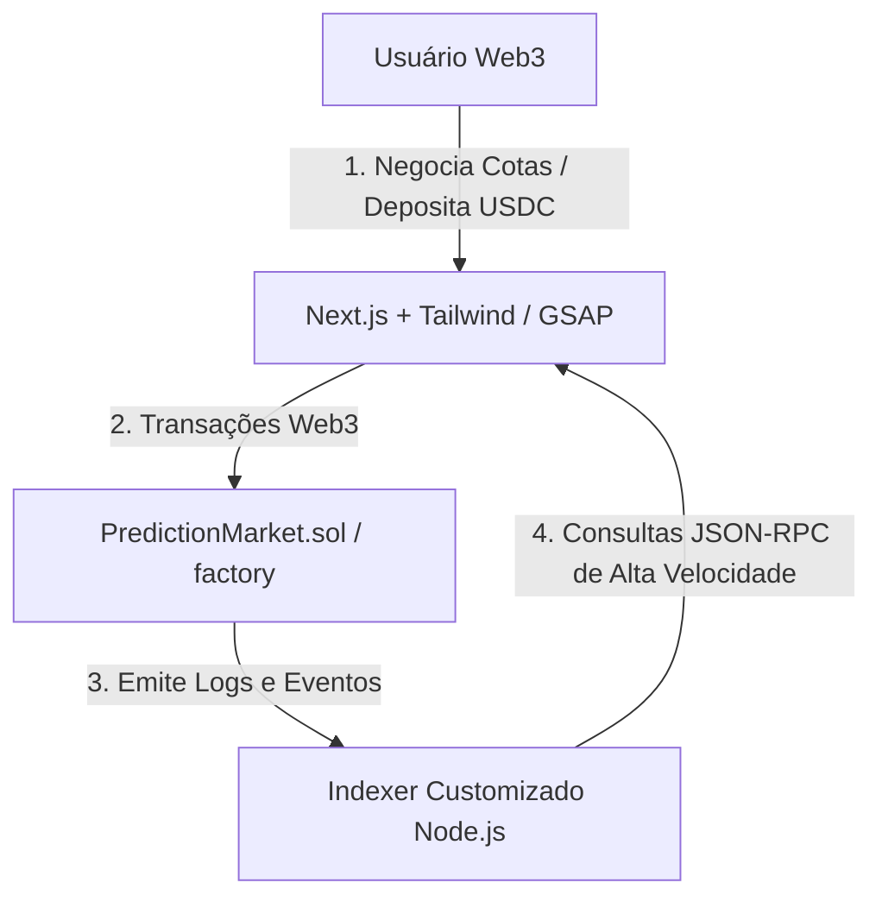

## A Visão: Mercados de Predição de Alta Fidelidade com Estética Cyberpunk

Os mercados de predição tradicionais geralmente sofrem com dois grandes problemas: a alta latência na execução e liquidação de negociações e a liquidez fragmentada ou escassa.

Com o surgimento da rede **Arc L1 Testnet (Circle L1)**, identificamos uma oportunidade de construir uma Prova de Conceito (PoC) de mercado de predição de alta fidelidade (**Arcade**) que resolve esses desafios. O Arcade combina um design cyberpunk responsivo (tema Void Black e Neon Cyan) com um modelo de Formador de Mercado de Produto Constante (CPMM) para fornecer liquidez automatizada e contínua para cotas de eventos reais.


---

## Arquitetura Técnica & Fluxo de Dados

O Arcade é composto por três camadas interconectadas projetadas para entregar transações quase instantâneas e liquidez profunda:



---

## 1. Mecânica do Formador de Mercado de Produto Constante (CPMM)

Nos mercados de predição tradicionais, os livros de ofertas (order books) podem resultar em negociações não executadas por falta de contraparte. O Arcade mitiga isso representando os resultados das predições (por exemplo, SIM e NÃO) como cotas de tokens ERC-20 dentro de um pool de liquidez AMM. Utilizamos uma variação do **Formador de Mercado de Produto Constante** (invariante $x \cdot y = k$) onde:

*   $x$ representa a quantidade de cotas de **SIM** (YES) no pool.
*   $y$ representa a quantidade de cotas de **NÃO** (NO) no pool.
*   $k$ é o produto constante.

Quando um usuário adquire cotas, ele deposita USDC como garantia. O contrato emite quantidades equivalentes de cotas de SIM e NÃO, entrega as cotas do resultado escolhido ao usuário e vende as cotas restantes para o pool de liquidez, mantendo a invariante matemática intacta.

<LatexRenderer displayMode>{`\\text{Preço}_{\\text{SIM}} = \\frac{y}{x + y}`}</LatexRenderer>

Isso garante que a probabilidade implícita dos resultados sempre some 1 (ou 100%), gerando um ecossistema matematicamente equilibrado e autoajustável.

---

## 2. Smart Contracts em Solidity & Padrão Factory

Para tornar a criação de novos mercados de predição totalmente descentralizada, sem permissão e padronizada, implementamos o padrão de projeto Factory:

```solidity
// SPDX-License-Identifier: MIT
pragma solidity ^0.8.20;

import "./PredictionMarket.sol";

contract MarketFactory {
    address[] public allMarkets;
    address public immutable usdcToken;

    event MarketCreated(address indexed marketAddress, string question, uint256 endTime);

    constructor(address _usdcToken) {
        usdcToken = _usdcToken;
    }

    function createMarket(string calldata question, uint256 endTime) external returns (address) {
        PredictionMarket newMarket = new PredictionMarket(question, endTime, usdcToken, msg.sender);
        allMarkets.push(address(newMarket));
        emit MarketCreated(address(newMarket), question, endTime);
        return address(newMarket);
    }
}
```

Cada contrato `PredictionMarket` implantado custodia os colaterais em USDC, gerencia os saldos dos pools, calcula taxas e derrapagens (slippage) de swaps e distribui os pagamentos aos detentores das cotas vencedoras após a resolução do evento por um oráculo.

---

## 3. Testes de Invariantes com Fuzzing no Foundry

Como as contas matemáticas de CPMM lidam com trocas diretas de ativos, pequenos erros de arredondamento poderiam teoricamente ser explorados para drenar fundos dos pools. Para garantir a segurança máxima, criamos uma suíte completa de testes usando a ferramenta **Foundry**.

Além de testes unitários tradicionais, integramos **testes de fuzzing** para testar as invariantes sob condições extremas:

```solidity
function testFuzz_CPMM_Invariants(uint256 buyAmount) public {
    // Restringe os inputs para faixas de valores realistas
    vm.assume(buyAmount > 100 && buyAmount < 1_000_000 * 10**6);
    
    // Captura estado anterior
    uint256 initialK = market.x() * market.y();
    
    // Executa a simulação da compra
    vm.prank(user);
    market.buyYesShares(buyAmount);
    
    // Assegura que o produto k final é maior ou igual ao inicial (por arredondamentos)
    uint256 finalK = market.x() * market.y();
    assertGe(finalK, initialK, "Constante k do produto violada!");
}
```

Isso garante que, independentemente do volume de negociação, o pool permaneça financeiramente estável e os usuários nunca possam retirar mais USDC do que possuem direito.

---

## 4. Indexação de Eventos em Tempo Real

Para fornecer uma interface com tempo de resposta imediato, o frontend não faz consultas pesadas diretamente nos smart contracts da blockchain. Em vez disso, executamos um **indexador em Node.js** dedicado que:

1.  Se inscreve nos eventos de `MarketCreated` e negociações emitidos pelos nós RPC da Arc L1.
2.  Persiste esses logs em um banco de dados estruturado.
3.  Fornece rotas de API rápidas para o frontend renderizar o histórico de volume, liquidez acumulada e gráficos de flutuação de probabilidade instantaneamente.

---

## Conclusão

Combinando a rapidez de confirmação da **Arc L1 (Circle)** com um modelo de **AMM de Produto Constante** e testes automatizados robustos, o Arcade demonstra como as plataformas de mercados de predição modernas podem ser: rápidas, seguras, líquidas e imersivas.
